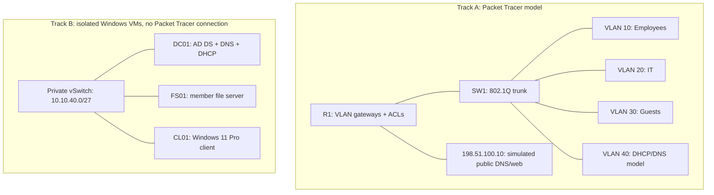

# Enterprise IT Support & Network Administration Lab

A reproducible small-office support lab covering network segmentation, Windows identity, account lifecycle operations, and troubleshooting. The scenario is a 40-person office with employee devices, an IT workstation, shared files, and visitors who must not reach internal services.

**Status:** source files and offline tests are implemented. A Windows domain and Packet Tracer topology have **not** been deployed or verified for this repository. See [test results](docs/test-results.md) for exactly what was run. The support tickets are labeled simulations, not completed customer incidents.

## What is included

- Four VLANs, an address plan, router-on-a-stick configurations, DHCP relay, guest DHCP, and inbound ACLs.
- Windows Server 2022 Desktop Experience runbook for AD DS, DNS, DHCP, OUs, groups, domain joining, file permissions, and Group Policy.
- Nine operational PowerShell scripts plus a common parsing/validation module. Account creation defaults to a plan and creates disabled accounts when applied.
- Ten [support exercises](tickets/README.md) with diagnosis, controlled fault injection, root cause, recovery, and acceptance checks.
- Python policy tests, PowerShell offline assertions, and GitHub Actions for Windows PowerShell 5.1 and PowerShell 7.

## Architecture and execution boundary



These are two complementary tracks, not one connected deployment. Track A uses Server-PT to model DHCP/DNS, **not** Active Directory. Track B puts its VMs on one private subnet to make Windows exercises reproducible without routing hardware. The VLAN security boundary is tested only in Track A. A routed VM extension would require a real virtual router/firewall and a new validation pass.

## Start here

1. Read [scope and security](SECURITY.md) and [architecture](docs/architecture.md).
2. Build [Track A](docs/network.md) and/or [Track B](docs/windows-deployment.md).
3. Run the [PowerShell tools](scripts/README.md) in plan/WhatIf mode before applying changes.
4. Work through the [tickets](tickets/README.md) and record actual results using [acceptance procedures](docs/acceptance.md).

Clone and run offline tests (Python 3.12 and PowerShell 7; no third-party test libraries):

```sh
git clone https://github.com/lacetears/enterprise-it-infrastructure-lab.git
cd enterprise-it-infrastructure-lab
python -m unittest discover -s tests -v
pwsh -NoProfile -File tests/Test-Offline.ps1
```

On Windows, also run `powershell -NoProfile -File tests/Test-Offline.ps1`. Follow your normal execution policy; do not globally disable it. Use Windows PowerShell 5.1 for the AD/GroupPolicy operational scripts with the documented RSAT modules.

## Engineering decisions

- Disabled-first provisioning avoids shared initial passwords. A failed group assignment leaves a disabled account for review rather than silently deleting or enabling it.
- Input is validated as a batch before directory writes. Existing users are skipped rather than overwritten; this is conservative repeatability, not desired-state reconciliation.
- Employee-to-server traffic is broad inside the disposable model because AD uses more than LDAP and DNS, including dynamic RPC. This is documented rather than presented as production least privilege.
- The guest ACL permits only modeled public DNS/web and blocks internal addresses. It is a stateless training policy, not an internet firewall.
- Event fields are parsed from XML by name rather than localized event message text. Reports are bounded and flag truncation.
- The Windows track uses a member server for file sharing rather than placing business shares on a domain controller.

## Where this demonstrates useful work

Support technicians can trace an incident from endpoint symptoms through DNS, DHCP, identity, policy, and permissions. Network support candidates can explain VLAN membership, relay selection, wildcard masks, and ACL order. Systems administration candidates can discuss safe account changes, domain DNS dependencies, GPO scope, and evidence collection.

## Limitations and next improvements

There is no production deployment, internet gateway, redundancy, central monitoring, MFA integration, automated VM build, or verified `.pkt` file. Device configs are text templates intended for the named Packet Tracer models; syntax and packet behavior still require simulator validation. Screenshots will be added only after a real lab run. Next steps are a recorded acceptance run, a second DC with a recovery exercise, and a routed VM variant with host-firewall policy.

[Architecture](docs/architecture.md) · [Deployment](docs/windows-deployment.md) · [Test results](docs/test-results.md) · [Sources](docs/references.md)
