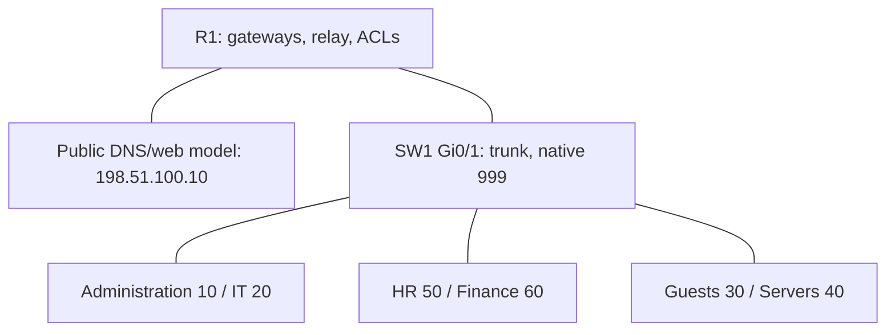

# Departmental office variant

Fictional business: Rio Office Services, a 40-person back-office business. Administration coordinates orders, HR handles employee records, Finance handles billing, IT administers devices, visitors use a separate network, and servers host shared services. This is a learning scenario, not employment experience.

This is a **separate build** under `network/departments/`. Start with blank 2911/2960 devices or a copy of the baseline, not a partial mix of both configurations. The original four-VLAN files remain unchanged. The department variant is statically checked but has not been run in Packet Tracer.

| VLAN | Department | Network | Gateway | Access ports | DHCP |
|---|---|---|---|---|---|
| 10 | Administration | 10.10.10.0/24 | .1 | Fa0/1-4 | .100-.199 |
| 20 | IT | 10.10.20.0/27 | .1 | Fa0/5-6 | .10-.29 |
| 30 | Guests | 10.10.30.0/24 | .1 | Fa0/7-8 | .100-.199 |
| 40 | Servers | 10.10.40.0/27 | .1 | Fa0/9-10 | Static .10 and .11 |
| 50 | HR | 10.10.50.0/27 | .1 | Fa0/11-12 | .10-.29 |
| 60 | Finance | 10.10.60.0/27 | .1 | Fa0/13-14 | .10-.29 |
| 999 | Unused/native | None | None | Fa0/15-24, Gi0/2 shut | None |

Switch management is 10.10.20.2/27. All dotted host ranges use their row's subnet. Existing /24 employee and guest ranges are preserved for continuity; /27 is adequate for the smaller HR/Finance training segments. Port counts represent sample endpoints, not all 40 desks. A second access switch is a future exercise.



The paired labels shorten the drawing; each department is a distinct VLAN. R1 Gi0/0 connects SW1 Gi0/1. The public-services model connects directly to R1 Gi0/1. No ISP, NAT or internet access is configured.

## Access policy and tradeoffs

| Source | Allowed through router | Denied through router |
|---|---|---|
| Administration, HR, Finance | DHCP; own gateway echo; server subnet | Other departments, IT, guests and public model |
| Guests | DHCP; own gateway echo; public model DNS TCP/UDP 53 and web TCP 80/443 | Internal destinations and all other public-model services |
| IT | No inbound data ACL; VTY SSH restricted to IT sources | No blanket routed deny; destination ACL return paths can prevent sessions |
| Servers | No inbound data ACL | No router restriction on server-initiated traffic |

Broad department-to-server permits are a deliberate simple baseline, not application least privilege. A compromised server has wider reach. ACLs are stateless: IT-initiated sessions into departments are not generally usable because replies to IT are denied at department ingress. Do not call this an endpoint remote-management design. Same-VLAN traffic bypasses router ACLs, including guest peer traffic. Department VLANs do not replace NTFS/share permissions.

## Build

Follow [baseline equipment and console setup](network.md), but paste only the variant [R1](../network/departments/R1.cfg) and [SW1](../network/departments/SW1.cfg) files. Use five PCs: ADMIN01 at Fa0/1, IT01 at Fa0/5, GUEST01 at Fa0/7, HR01 at Fa0/11, FIN01 at Fa0/13. Keep the three Server-PT models and addresses from the baseline. Configure four server DHCP pools from [the variant CSV](../network/departments/dhcp-pools.csv). Guests still lease from R1. Configure server DNS records exactly as the baseline. Renew all five clients and compare mask, DNS and gateway with this table.

Console credentials and RSA keys remain manual. Finish console SSH setup before testing IT SSH. Do not publish credentials or credential-bearing topology files. Record rejected commands, model and simulator version. Save a real `.pkt` only after running acceptance cases; no fabricated `.pkt` is supplied.

## Packet walk: HR to file-service model

1. HR01 at 10.10.50.10/27 wants 10.10.40.11. Its mask says the server is off-subnet, so it ARPs for gateway 10.10.50.1, not for the server.
2. HR01 sends an Ethernet frame to R1's MAC, with IP destination still 10.10.40.11. Fa0/11 accepts the untagged frame in VLAN 50.
3. SW1 forwards it on Gi0/1 with tag 50. R1 Gi0/0.50 receives it and evaluates HR_IN inbound. The server-subnet permit matches.
4. R1 finds its connected 10.10.40.0/27 route, decrements TTL and uses ARP to find 10.10.40.11. It creates a new Ethernet header and transmits tag 40 through Gi0/0.40.
5. SW1 removes the tag on Fa0/10. The server receives the packet and sends its reply through 10.10.40.1. There is no server ingress ACL and no HR egress ACL, so the reply can return, subject to host/service behavior.
6. Replace the destination with Finance 10.10.60.10. HR_IN reaches deny before forwarding. Verify the denial with counters/simulation, not merely a timeout.

The Windows VM track remains separate on one private subnet. These configs do not deploy departmental Windows VLANs or AD permissions.

## Acceptance still required

For every department: lease, own-gateway ping, internal A-record lookup, HTTP to .40.11, forbidden department access. For guest: public DNS/web success, internal DNS/web denial. For IT: router/switch SSH with real unique credentials. Test negative cases using services known to work from an allowed source. Capture actual observations using [the record template](acceptance-record.md).

Run static checks from the repository root:

```sh
python tools/check_design.py network
python tools/check_design.py network/departments
python -m unittest discover -s tests -v
```

These parse supplied text and evaluate selected policy cases. They cannot prove IOS command acceptance, ARP behavior, DHCP relay operation or an actual application session.
